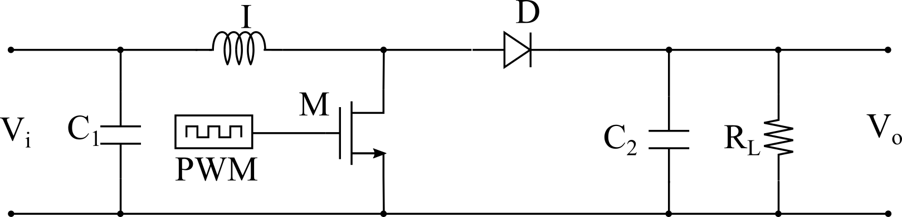

# InkscapeCircuitSymbols

 Circuit symbols for drawing schematics and block diagrams with Inkscape

## Example

## Requirement

- Inkscape

## Usage

1. Download and open electrical_symbol.svg.

2. Copy and paste the file to the `~/.config/inkscape/symbols`. (Linux)

3. Every dilemma you met can be solved with ChatGPT.

## Contribution

Thanks for the source file of https://github.com/keikawa/InkscapeCircuitSymbols.git, this work is mostly based on his/her work, because my instructor needs me to do in a form he specified.

## Licence

MIT Licence
